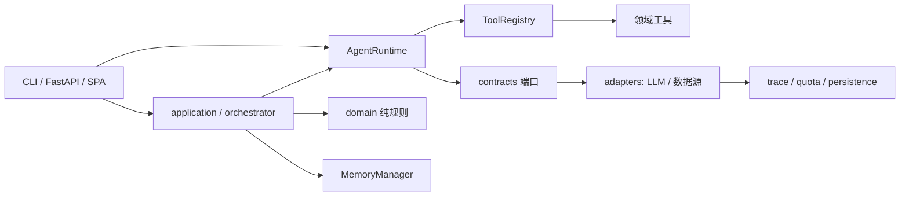

# LightTrail（光迹）架构

**版本：v3.2 ｜ 基线：2026-09-22 代码审计；状态核对：2026-10-02**

LightTrail 是摄影拍摄决策引擎。确定性摄影任务走灵感、规划、临场、复盘四条管线；开放问答走 AgentRuntime。目标输出是结论、行动、依据、来源和降级原因。下图描述当前保留的架构边界，不代表所有生产入口已经完成接线。

## 分层与边界

| 模块 | 职责 | 约束 |
|---|---|---|
| `contracts/` | 跨层模型与端口 | 零依赖；契约唯一真源 |
| `domain/` | 领域模型与纯规则 | 不依赖应用、适配和交互层 |
| `tools/`、`memory/`、`orchestrator/` | 摄影规则、记忆和四管线 | 不反向依赖 `adapters/` |
| `application/` | 组合领域能力完成用例 | 不承载 UI 细节和供应商判断 |
| `runtime/` | AgentRuntime、注册表、上下文 | 只消费契约与领域工具 |
| `adapters/` | LLM、配置密钥、外部数据实现 | 实现端口，不包含业务决策 |
| `api/`、`cli.py`、`frontend/` | 交互和展示 | 不承载领域规则 |
| `composition.py` | 唯一装配根 | 唯一允许跨层构造对象 |

`import-linter` 用于强制 contracts 零依赖、领域不反向依赖 adapters、交互层不被下层依赖。R0-1 已复验当前项目虚拟环境中的命令：3 条契约保留，0 条违反。

## 关键机制

- 工具以 `ToolSpec` 声明；`ToolRegistry` 生成 schema、分发、trace 元数据和置信度入口。
- LLM 使用 `LLMProvider` / `SyncLLMClient` 端口；模型选择经 `ModelRouter` 能力声明。
- 并发由 `LLM_CONCURRENCY` 配置，默认 4；设置为 1 即串行。适配层使用单一限流器与统一重试，详见 ADR-004。
- 记忆按 `data/users/{user_id}/memory/` 隔离：档案、事件、用户语义可写；领域知识种子全局只读。
- `TraceRecorder` 记录工具、步骤和 LLM 事件，SSE 将轨迹传给前端；无数据时明确降级。
- Pydantic 契约导出 OpenAPI，前端 TypeScript 由 `npm run gen:api` 生成。
- `knowledge/` 是全局只读知识层：相机规格走 YAML 精确查询，事实文本走 SQLite FTS5 中文检索，命中片段携带来源后按需注入上下文。
- 路由规则优先命中四条管线；显式复合任务进入受步数限制的 Planner，未命中规则的请求经可审计 LLM 意图路由，Planner 执行仍只走 `ToolRegistry.dispatch`。

## 当前状态与已知接线缺口

B0–B7 的模块重构已经完成，当前代码有 15 个声明式工具、全局知识库、规则优先路由、受控 Planner、FastAPI/SSE 和六页 SPA。R0-1 已统一 API、CLI 和 evals 的 `ApplicationServices`/`RequestScope` 装配：同一服务对象提供主/深推理模型路由、配额、知识和记忆；请求作用域提供用户身份、工具上下文、trace 与独立运行时。R0-2 使 Web `/api/decide` 经过 `Orchestrator.plan()`，固定管线、受控 Planner、超工具集边界和 ReAct 回落共享入口，深推理走 reason model，配额高水位与管线步数上限均在执行前检查。R0-3 使 ReAct 的事件检索和动态记忆注入使用当前请求用户目录，知识命中保持全局只读，记忆与知识来源进入 API trace。R0-4 使照片分析与反推从当前请求用户档案读取器材，共用应用模型能力路由；反推使用独立系统提示词，照片上传临时文件由 SSE worker 在处理完毕后清理。R0-5 以请求时刻和时区解析目标日期，明确地点选择优先级，使用本轮题材采集数据，并让决策卡的结构化地点、日期、题材与目标一致；冲突结果保守降级。R0-6 修正前端曝光三角、D2 当前选择和 D4 事件确认的确定性行为。现存缺口如下：

- S1-1 已定义 `PlanningRequest`/`SpotPlan` 契约。S1-2 已将收藏机位 CRUD 接入本地用户档案，验证坐标、坐标系、时区与来源；旧机位逐条确认前只读展示，未知坐标系及 GCJ-02/BD-09 不进入现有 WGS84 计算。`PUT /api/profile` 不再直接写机位列表。S1-3 已接入 M1 图形编辑器、删除二次确认和本次机位 ID 交接。S1-4 的 `/api/spot-plans` 使用本轮题材、日期和当前用户机位 ID 生成结构化计划，缺天气等关键事实时返回 `needs_data`。S1-5 的 `/api/spot-plans/archive` 和 `/replay` 将已验证计划转换为无结构化经纬度的版本化快照并校验离线回放；D2 URL 只保存题材、日期和机位 ID，恢复时由当前用户机位列表确认。E1 的完整 `CaptureEvent` 关联仍未接线。
- D4 目前只在浏览器当前页以临时 Object URL 预览已选照片，不保存原图；照片与事件的稳定关联留待 E1。D2 已有主动加载的高德机位图层，浏览器只向本机后端提交机位 ID，后端从当前用户档案核验并转换已确认的 WGS84 坐标为 GCJ-02，列表与标记共用机位 ID；JS 安全密钥只在本机受限样式代理中使用，坐标转换由服务端独立使用 Web 服务 Key。合成城市中心的 JS 地图初始化及一次公开地点合成坐标转换成功，未外发真实收藏机位坐标。S1-4 已完成本地验收；费用和许可未经独立核实，且当前 `_local` 无身份认证，因此不得对公网开放该代理。道路路线图层依赖 O1-2/3 的真实路线几何；现有手工耗时和直线距离不得称为道路导航。
- Web 当前恒用 `_local` 用户身份，无注册、登录或认证；CORS 在本地开发仍为 `*`。档案/事件/语义记忆虽按 `user_id` 分目录，会话虽记录归属字段，但尚不能作为公网多用户服务。照片画面会交给已配置的多模态模型，档案摘要和检索记忆可进入模型上下文；数据流与告知规则需在 P1 隐私收口时明确。
- R0-7 已将 L2 管线回放改为逐用例独立离线夹具，结构化核对地点、日期、题材、工具、事实、降级及个性化来源；L3 报告保留语义通过数。旧分组 cassette 只作为历史证据，v2 合成样本不代表真实第三方数据或线上决策质量。
- R0-8 已将开发依赖安装、import-linter、OpenAPI 生成、前端构建与 UI 检查在全新环境复验；领域知识 FTS 对完整中文问句增加有界片段召回。真实 LLM 的本地 API 最小联调验证了模型路由、用户记忆和知识注入，拍摄工具结果仍用合成夹具，不能据此宣称实时数据准确。

这些是定向装配和语义修复问题，不构成再次全量重写的理由。当前执行顺序、原子任务和闸门只以 `docs/AGENT-ROADMAP.md` 为准。
