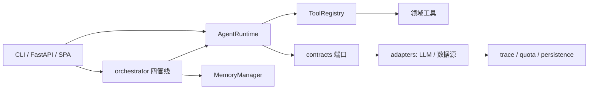

# LightTrail（光迹）架构

**版本：v3.1 ｜ 基线：B0–B7 重构收口（2026-09-16）**

LightTrail 是摄影拍摄决策引擎。确定性摄影任务走灵感、规划、临场、复盘四条管线；开放问答走 AgentRuntime。每次决策输出结论、依据、来源、置信度和降级原因。

## 分层与边界

| 模块 | 职责 | 约束 |
|---|---|---|
| `contracts/` | 跨层模型与端口 | 零依赖；契约唯一真源 |
| `tools/`、`memory/`、`orchestrator/` | 摄影规则、记忆和四管线 | 不反向依赖 `adapters/` |
| `runtime/` | AgentRuntime、注册表、上下文 | 只消费契约与领域工具 |
| `adapters/` | LLM、配置密钥、外部数据实现 | 实现端口，不包含业务决策 |
| `api/`、`cli.py`、`frontend/` | 交互和展示 | 不承载领域规则 |
| `composition.py` | 唯一装配根 | 唯一允许跨层构造对象 |

`import-linter` 强制 contracts 零依赖、领域不反向依赖 adapters、交互层不被下层依赖。

## 关键机制

- 工具以 `ToolSpec` 声明；`ToolRegistry` 生成 schema、分发、trace 元数据和置信度入口。
- LLM 使用 `LLMProvider` / `SyncLLMClient` 端口；模型选择经 `ModelRouter` 能力声明。
- 并发由 `LLM_CONCURRENCY` 配置，默认 4；设置为 1 即串行。适配层使用单一限流器与统一重试，详见 ADR-004。
- 记忆按 `data/users/{user_id}/memory/` 隔离：档案、事件、用户语义可写；领域知识种子全局只读。
- `TraceRecorder` 记录工具、步骤和 LLM 事件，SSE 将轨迹传给前端；无数据时明确降级。
- Pydantic 契约导出 OpenAPI，前端 TypeScript 由 `npm run gen:api` 生成。
- `knowledge/` 是全局只读知识层：相机规格走 YAML 精确查询，事实文本走 SQLite FTS5 中文检索，命中片段携带来源后按需注入上下文。
- 路由规则优先命中四条管线；不确定的复合任务才经可审计 LLM 路由并进入受步数限制的 Planner，执行仍只走 `ToolRegistry.dispatch`。

## 当前状态

B0–B7 架构重构已完成。当前代码有 15 个声明式工具、全局知识库、规则优先路由与受控 Planner；后续只按 `docs/POST-REFACTOR-ROADMAP.md` 推进真实产品闭环。
