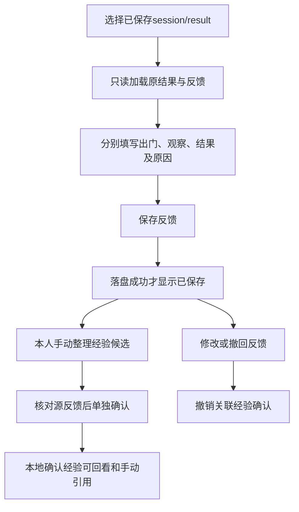

# U5 最小结果回流设计（已采纳）

## 实施授权与字段补充（2026-10-11）

本人已采纳本设计并授权按路线图实现U5-1至U5-5，仅本地离线开发与验收。下文原设计交付状态保留为历史；本节及路线图最新门禁覆盖原“待批准”措辞。禁止真实调用、读取原真实隔离材料、上传照片、接入Agent记忆、进入U6、提交或发布。

- 反馈修改：尚未撤回的经验转为needs_review，confirmed_at清空，保留旧source_feedback_revision。needs_review不能直接确认；本人核对并重新保存候选（即使正文相同），转为draft并绑定当前反馈版本后，再执行独立确认。
- 已撤回经验不因反馈修改复活。经验撤回保留experience_id、kind、source_feedback_revision，status=withdrawn，content=null、confirmed_at=null、withdrawn_at为服务端时间。重新整理生成新ID、draft、withdrawn_at=null，不继承确认。
- 反馈撤回：feedback=null、experience=null、photo_refs=[]，feedback_revision递增；保留feedback_id/target/created_at，记录withdrawn_at。重新填写必须携带最新revision，experience仍为null。
- 当前源改变或丢失时，GET保留可读记录但experience_effective=false；不在只读恢复中改写文件。仅允许撤回，禁止编辑及确认。经验有效须同时满足active、confirmed、当前反馈版本及源未改变。
- 重复操作仅按最近mutation_id及完整操作摘要去重；其他操作必须通过最新revision。无经验时撤回经验、无反馈时撤回反馈返回当前状态，不创建文件；已撤回记录不重复增版。单进程共享锁覆盖读、CAS、裁决和替换。

日期：2026-10-11（Asia/Shanghai，+08:00）。状态：历史设计交付后已获本人采纳及U5-1至5本地实施授权，现已完成。实际代码与V01–V15见[实施验收](../audit/2026-10-11/u5-verification.md)。执行顺序和门禁以[路线图](../AGENT-ROADMAP.md)为准。

## 1. 推荐结论与首个案例

推荐为每个已保存结果增加一份**按用户隔离的独立反馈 JSON**，通过稳定的 `session_id/result_id` 关联原结果。反馈修改、撤回和经验确认均只更新这份文件；原会话、原卡、原有效期及工具快照保持原样。每个结果首版只维护一条当前反馈和最多一条经验候选，无完整 CaptureEvent、数据库迁移或全量旧数据重写。

首个案例事实来自本人陈述：**原计划已保存，但本人没去，无独立现场观察；现场效用无法判读。** 因而出门状态为 `not_went`、观察状态为 `not_observed`、观察结果为 `null`，未出门原因保持未提供。不能记录为“天象没出现”“预测失败”或“成功避坑”，也不据此结束U4。[原真实生成与恢复](../audit/2026-10-09/u4-real-verification.md)及[最新技术验收](../audit/2026-10-11/u4-aperture-assertion-verification.md)继续保留。

首版经验采用**本人手动整理候选→单独确认→可回看和手动引用**。确认记录与原始反馈分开，但存储在同一文档以便原子撤回；首版不调用 `MemoryManager.add_event`、`semantic_propose/confirm` 或自动沉淀，不把这些条目接入 Agent 注入。页面明确“已确认本地经验，尚未纳入Agent记忆”。这是推荐的首版范围，不把“可复用”宣称为模型已学会；若评审要求确认后立即参与模型建议，需另定来源、过滤及撤回的记忆接线任务，不能隐含采用现有不完整接口。

## 2. 与现有存储对照

以下是本批静态核对的现状，不是新功能验收。

| 现有机制 | 已有行为与缺口 | 本设计取舍 |
|---|---|---|
| [SessionRecord / SavedResult / SessionManager](../../src/lighttrail/api/session.py) | `data/sessions/{session_id}.json`；结果有独立ID、版本、原卡/计划/历史/快照。保存合并既有版本，临时文件＋`os.replace`后才更新缓存。`from_dict`忽略未知字段，普通保存可能丢弃后来附加字段。 | 保持文件和契约不变；不把可修改反馈塞进 `results`、`workspace` 或临时新增会话键。 |
| [结果读取与归属校验](../../src/lighttrail/api/routes.py) | GET按稳定ID只读恢复；`_owned_session`使用RequestContext，空旧用户归 `_local`；他人会话与不存在会话均404。 | 复用同等归属规则，反馈新端点也必须检查；GET不执行重新生成、天气更新或写入。 |
| [EventStore](../../src/lighttrail/memory/events.py)及`POST /api/events` | SQLite拍摄事件有outcome、时间、地点等；没有该结果引用、独立未观察语义和单条撤回闭环，且会被检索注入与聚合。 | 不把“没去”映射为fail写入事件，不迁移events表，不使用旧事件入口保存U5原始反馈。 |
| [SemanticStore](../../src/lighttrail/memory/semantic.py) | 候选仅在内存，确认写入JSON；条目无稳定来源ID、确认版本和已确认条目撤回接口。普通写文件，确认先改内存。 | 首版不复用该写入链；反馈与经验在一份原子文件中保存，不产生跨文件事务或污染旧语义库。 |
| [MemoryManager](../../src/lighttrail/memory/manager.py) | 按 `users/{user_id}/memory/` 隔离；事件/已确认语义可被注入，原始反馈不是已有独立存储类型。 | 新目录与memory平级；单纯反馈不会成为事件或注入块。 |
| [useSavedResults](../../frontend/src/api/savedResults.ts)、[SavedHistory](../../frontend/src/components/SavedHistory.tsx) | 当前页按稳定指针恢复；RequestScope拒绝迟到回写；重查是独立的新版本动作。 | 反馈面板绑定选中版本，使用独立请求状态；不借用重查或SSE生成路径。 |

与“给会话加数组”相比，独立文件多一个很小的存储职责，但避免反馈改写原会话、旧会话序列化丢字段、版本保存与反馈相互覆盖。与扩展SQLite/semantic相比，无需迁移旧库，也不需要协调反馈与记忆两个写入事务。代价是首版确认经验仅可回看/手动引用，不自动用于未来生成；接受单进程、本地单用户部署边界，不新建公网身份体系。

只读边界需要在实施时单独保证：当前SessionManager.get/restore可能触发LRU淘汰，`_persist_evicted`会为尚无磁盘文件的旧缓存会话写盘。因此新反馈的来源解析应只读取已落盘的会话快照并沿用SessionRecord的legacy映射及归属规则，不能借get/restore把缓存淘汰写入带进来；未落盘会话不能创建反馈。此处是静态设计发现，不改写既有U3正常恢复通过的事实，也不在本批修生产代码。

## 3. 数据结构及不可混淆的语义

### 3.1 文件与标识

建议位置：`data/users/{context.user_id}/result-feedback/{session_id}/{result_id}.json`。用户身份只来自服务端RequestContext；写请求不接受 `user_id`、伪造确认人或目标ID覆盖。

`feedback_id`是首存时生成的UUID，后续修改、撤回、重新填写均保留；一组用户＋session/result只有一条记录。`revision`是整份文件的单调版本，用于比较并更新；顶层`feedback_revision`只在原始反馈内容修改或撤回时增加，经验确认绑定这个版本，撤回清空payload时也保留此计数。

路径片段只接受既有安全字母/数字/下划线/连字符（长度1–128），结果ID为既有UUID或精确的 `legacy`；拒绝斜杠、`..`及路径穿越，拼接后检查仍在指定用户目录下。API路径是目标真源，URL仅含ID，不含反馈正文、照片路径或坐标。

### 3.2 字段

| 字段 | 取值与首版规则 |
|---|---|
| `schema_version` | 文件格式固定为1；缺文件表示尚无反馈，不创建空文件。未知版本显式报不支持，不静默清空或覆盖。 |
| `target` | `session_id`、`result_id`、`source_fingerprint`。后者由服务端对首次关联的原结果规范JSON计算SHA-256，防止旧legacy内容变化后沿用旧反馈。不复制原卡或精确坐标。 |
| `user_id` | 服务端写入并与目录、RequestContext、会话归属核对；客户端只读。 |
| `status` | `active`或`withdrawn`；“无反馈”是GET派生状态 `none`，不推断为未出门。 |
| `revision`、`feedback_id` | 服务端维护，不允许客户端指定新保存版本或另造反馈ID。 |
| `feedback_revision` | 顶层原始反馈版本；修改/撤回增加，经验操作不增加；撤回后feedback为null但此计数保留。 |
| `feedback.departure_status` | `went / not_went / unknown`，分别为本人报告出门、未出门、未提供。 |
| `feedback.observation_status` | `observed / not_observed / unknown`，指本人是否做过独立观察，不从出门状态自动推断。 |
| `feedback.observation_result` | 本人已观察时必选 `seen / not_seen / uncertain`；未观察或观察状态未知时必须为null。`not_seen`文案为“在所述观察范围内未看到”，不表示全局没出现。 |
| `feedback.observation_scope` | 已观察时必填对象：`place_matches_plan`、`window_covers_plan`均为 `yes / no / unknown`，`description`为本人简述（1–300字）；其他状态必须null。不解析或采集GPS。 |
| 三类原因 | `departure_reason`、`observation_reason`、`result_reason`均为可选本人文本（null或1–500字）。分别记录出门选择、观察状态、结果判断原因；不知道就留null，不从原卡或模型推断。未观察时 `result_reason` 必须null。 |
| `feedback.note` | 可选原始补充（最多1000字），保留本人表述，不使用LLM改写。 |
| `experience` | null，或一条独立候选/确认记录，见3.4；保存原始反馈不创建候选。 |
| `photo_refs` | 缺省空数组；首版仅允许空数组。非空提交422，不能通过填路径或ID触发上传、EXIF、分析或存储。 |
| 时间 | `created_at / updated_at / withdrawn_at`为服务端带时区时间；反馈时间不是实际拍摄时间，不覆盖原结果的目标、获取、评估或有效期。 |

首版允许保留部分信息：例如went＋unknown表示出门但未说明是否观察。页面默认均为“未提供”，不能预选“去了”或“未观察”。两项都unknown也可保存本人备注，但页面显示“反馈信息未完整”，不生成结果判断。未知枚举、冲突组合、超长字段或额外写入身份/系统字段均422，不能默默矫正为另一事实。

### 3.3 状态组合与反馈修改

| 出门 | 观察 | 观察结果 | 可保存及页面含义 |
|---|---|---|---|
| not_went | not_observed | null | 首例；“未出门 · 未观察 · 现场效用无法判读”。未出门原因可留空。 |
| went | not_observed | null | 已出门但本人没观察；不能评为天象没出现或预测失败。 |
| not_went | observed | seen/not_seen/uncertain | 不一律拒绝，例如本人在家观察；要求填写观察范围，不能自动当作计划机位的现场验证。 |
| went或unknown | observed | seen/not_seen/uncertain | 要求明确观察范围；地点/窗口匹配未知或不匹配，显示“不能据此判读原机位完整窗口”。 |
| 任意 | unknown或not_observed | seen或not_seen | 422；提示先确认是否观察。 |
| 任意 | observed | null | 422；本人需选择看到、未看到或不确定，后者也算合法结果。 |

修改原始反馈采用完整替换当前payload，不自动清空矛盾字段后保存。页面切换为未观察时，明确显示并要求用户确认清除旧观察结果/范围；用户取消则不提交。服务器仍做同样的组合校验。

任何原始反馈修改都使关联经验转为 `needs_review` 并清除 `confirmed_at`，不沿用旧确认，即使只改了原因。页面提交前提示“修改反馈将撤销本条经验的确认，需重新核对”；经验原文本可留在候选中，但不再视为有效经验。首版只保留当前反馈，不存储所有旧原始文本；版本号用于防止覆盖和失效确认，不声称已有完整修改审计历史。

### 3.4 经验与本人确认

经验对象含 `experience_id`（UUID）、`kind`（`planning_preference / observation_note`）、`content`（1–500字）、`status`（`draft / confirmed / needs_review / withdrawn`）、`source_feedback_revision`、`confirmed_at`。内容由本人手动填写，后端不能从“没去”自动总结偏好或天气结论；模型输出也不能触发confirm。

第一次整理或撤回后重新整理生成新的experience_id；同一候选编辑保留ID。confirmed与needs_review状态的编辑均回到draft，并绑定当前feedback_revision。旧候选ID或旧源版本不能再次确认，新候选也不能继承确认时间。

- `planning_preference`：本人确认的安排偏好或待办经验。无观察时可以写，但不能被标为某次天象事实。例如“以后出发前先检查计划是否过期”仅是可供本人填写的建议示例，**不代表小北已确认这条经验或未出门原因**。
- `observation_note`：需要observation_status=observed、合法结果及范围。未观察时服务器拒绝该种经验确认；不把not_seen命名为“天象没出现”。即使计划地点/窗口匹配，也只记录一次本人报告，不生成概率、命中统计或“稳定规律”。
- 保存候选、确认经验、撤回经验是不同动作。confirm必须传本人明确操作标志 `confirmed_by_user: true`，服务端重读当前反馈并校验目标与版本；“保存反馈”不能顺带confirm。
- 自由文本仍可能写错，首版只校验结构和资格，不承诺通用文本事实核验。确认页同时展示原反馈状态及“单次本人记录，未经独立校准”；无观察的规划经验明确附“本次无现场观察”标记。
- 已确认经验被编辑时回到draft，清除确认时间；不保留自动确认。撤回经验不撤回原始反馈；撤回原始反馈同时清除候选和已确认经验，避免孤立复用。
- 首版“确认”只授权保存本地经验条目并在反馈页面回看/手动引用，`memory_written=false`。不写events/semantic，不调用sediment，不纳入已有注入块。未来若增加“供以后建议使用”，必须另设明确动作及来源撤回门禁，不能从本次确认反推为已有授权。

## 4. 字段与API样例

以下ID、时间及fingerprint为合成占位，不能直接用来回放原真实轮次，也不在本批把首例写入真实数据目录。

### 4.1 保存首例的请求

目标由路径 `/api/sessions/{session_id}/results/{result_id}/feedback` 指定；JSON只携带可编辑内容和并发版本。

```json
{
  "expected_revision": 0,
  "mutation_id": "cccccccccccc4ccc8ccccccccccccccc",
  "feedback": {
    "departure_status": "not_went",
    "observation_status": "not_observed",
    "observation_result": null,
    "observation_scope": null,
    "departure_reason": null,
    "observation_reason": null,
    "result_reason": null,
    "note": "本人未出门，无独立现场观察，现场效用无法判读。"
  },
  "photo_refs": []
}
```

`mutation_id`为每次本人提交生成的UUID。同一次请求的手动重试沿用，修改内容则新建；只用于最新一次提交的幂等确认，不是身份或历史记录编号。

### 4.2 已保存的首例文档

```json
{
  "schema_version": 1,
  "feedback_id": "dddddddddddd4ddd8ddddddddddddddd",
  "user_id": "_local",
  "target": {
    "session_id": "aaaaaaaaaaaa4aaa8aaaaaaaaaaaaaaa",
    "result_id": "bbbbbbbbbbbb4bbb8bbbbbbbbbbbbbbb",
    "source_fingerprint": "sha256:<服务端生成的64位十六进制摘要>"
  },
  "status": "active",
  "revision": 1,
  "feedback_revision": 1,
  "feedback": {
    "departure_status": "not_went",
    "observation_status": "not_observed",
    "observation_result": null,
    "observation_scope": null,
    "departure_reason": null,
    "observation_reason": null,
    "result_reason": null,
    "note": "本人未出门，无独立现场观察，现场效用无法判读。"
  },
  "experience": null,
  "photo_refs": [],
  "created_at": "2026-10-11T20:00:00+08:00",
  "updated_at": "2026-10-11T20:00:00+08:00",
  "withdrawn_at": null,
  "last_mutation": {
    "id": "cccccccccccc4ccc8ccccccccccccccc",
    "request_digest": "sha256:<本次规范请求摘要>"
  }
}
```

JSON示例中的摘要占位在实际实现时必须替换为有效SHA-256，示例不声称已通过生产契约验证。`last_mutation`只保留最近操作ID和请求摘要，避免重复点击/响应丢失后重复增版；GET响应不必公开这个内部字段。

### 4.3 已观察时的可编辑payload示例

```json
{
  "departure_status": "went",
  "observation_status": "observed",
  "observation_result": "not_seen",
  "observation_scope": {
    "place_matches_plan": "yes",
    "window_covers_plan": "unknown",
    "description": "合成案例：在计划地点观察过，但未确认是否覆盖完整计划窗口。"
  },
  "departure_reason": null,
  "observation_reason": null,
  "result_reason": "仅描述本人所述观察范围内未看到目标现象。",
  "note": null
}
```

页面展示“观察范围内未看到；完整窗口未确认，原计划现场效用仍无法完整判读”，不能改写原卡为skip或计算一次失败。

### 4.4 候选经验与确认请求示例

```json
{
  "expected_revision": 1,
  "mutation_id": "eeeeeeeeeeee4eee8eeeeeeeeeeeeeee",
  "kind": "planning_preference",
  "content": "合成待确认示例：以后出发前先检查计划是否过期。"
}
```

上例只保存draft；确认是新的请求，版本取刚返回的revision。

```json
{
  "expected_revision": 2,
  "mutation_id": "ffffffffffff4fff8fffffffffffffff",
  "experience_id": "11111111111141118111111111111111",
  "source_feedback_revision": 1,
  "confirmed_by_user": true
}
```

确认成功返回新revision及experience.status=confirmed，同时 `memory_written=false`；样例不代表本人已确认其中内容。

### 4.5 撤回后的核心字段示例

```json
{
  "status": "withdrawn",
  "revision": 4,
  "feedback_revision": 2,
  "feedback": null,
  "experience": null,
  "photo_refs": [],
  "withdrawn_at": "2026-10-11T20:15:00+08:00"
}
```

这是文档字段片段，完整tombstone仍保留schema_version、feedback_id、用户与target、created_at/updated_at及last_mutation。正文不会藏入history或日志，反馈端点也不把请求全文追加到原会话历史。

## 5. API流程、权限与失败

以下为拟议API，当前不存在。均为普通JSON请求；不走decide/chat、SSE、模型路由、天气、地图或图片工具。

设 `B=/api/sessions/{session_id}/results/{result_id}/feedback`。

| 端点 | 请求与结果 |
|---|---|
| `GET B` | 校验会话归属；返回 `{state: none, revision: 0, record: null}` 或当前record及 `source_state: unchanged / changed / missing`。反馈不存在返回200空态；目标本身不存在且无既有反馈时404。读取不创建文件或续期。 |
| `PUT B` | 创建或完整替换原始反馈；必带expected_revision、mutation_id。首次0，修改当前版本；成功返回200 `{saved: true, state: active, revision, record, memory_written: false}`。只有目标可核验且未变更时接受。 |
| `POST B/withdraw` | 必带expected_revision、mutation_id；成功返回200撤回确认。清空原始payload、经验及photo_refs，仅留ID、目标、单调版本、时间和最近操作摘要的tombstone。重复撤回可幂等返回现有撤回状态。 |
| `PUT B/experience` | 原始反馈active且来源有效时，保存/编辑一条本人手写draft；客户端不传status或confirmed_at。修改已有confirmed经验回到draft。 |
| `POST B/experience/confirm` | 当前草稿、experience_id及源反馈版本一致，明确confirmed_by_user=true，资格满足后确认；不写现有记忆。 |
| `POST B/experience/withdraw` | 撤回当前经验，保留原始反馈；清空经验正文及确认信息，保留经验ID与withdrawn状态即可。 |

对所有GET/写请求均返回 `Cache-Control: private, no-store`。GET只读，写操作沿现有本机Host、连接地址及写来源规则。跨用户检查先于读取反馈文件与业务校验，不以可猜ID作为权限；用户B对A的原结果/反馈/经验全部404，包括读、改、撤回、确认，不透露是否有反馈。当前默认 `_local` 无公网认证，这些测试只是身份上下文的隔离边界。

| 状态 | 客户端可观察行为 |
|---|---|
| 422 | 非法状态组合、观察范围缺失、未观察却确认观察经验、非空photo_refs、非法字段/ID；字段错误可定位，不写文件。 |
| 404 | 他人/不存在会话，或不存在目标；不新建会话、不换目标、不触发查询。 |
| 409 | revision冲突、目标指纹变化、同mutation_id内容不一致；保留草稿，提示重新读取和本人核对，不能覆盖。 |
| 500 | 文件写入或替换失败；返回明确 `saved:false` 和“反馈保存失败，未确认已保存”。撤回/确认失败同理，不显示已撤回/已确认。凭据与内部路径按既有规则过滤。 |
| 503 | 已存在文件损坏或schema不支持；显示“反馈暂不可读取”，不当成none，不以空文档覆盖。 |
| 传输中断/响应丢失 | 显示“保存状态未确认”，与服务端已明确保存失败分开。只GET核对当前revision及最后操作是否已生效；不自动重试写入、不生成新结果。 |

mutation去重与expected_revision检查必须在同一锁内：最近操作ID相同且规范请求摘要一致，先返回其当前结果，避免请求落盘但响应丢失时再增版；同ID不同摘要409。若该ID已被后续操作替换，不承诺永久幂等：旧expected_revision返回409，客户端GET核对，不重放旧操作。GET的公开响应可提供 `last_mutation_id`供本次确认，不暴露请求摘要。

## 6. 原子保存、撤回与兼容

### 6.1 保存一致性

未来实现使用单个共享存储实例和进程内写锁（首版全局一把即可），在锁内重读最新文件、校验expected_revision、构造新文档，写同目录唯一临时文件，再原子 `os.replace`。借鉴现有SessionManager的成功落盘后确认与Windows有限替换重试，不声称已复用完成。

对同一反馈的修改、确认、撤回共用锁与revision；不缓存未提交文档，文件替换失败仍读取旧完整记录。确认、原始修改导致经验失效、撤回清空经验都在同一文件一次替换，避免反馈已撤回而经验仍有效。正常异常后清理本次临时文件；不新增真实数据清理任务，不夸称原子替换保证所有断电/文件系统故障耐久性。

首版不承诺多worker或多进程同时写入；部署保持单进程，不能以进程内锁宣称跨进程事务。未来扩展时再选择文件锁或事务后端，不在U5设计批次迁移数据库。

### 6.2 撤回与重新填写

撤回成功后，feedback和experience均为null、photo_refs为空；tombstone保留稳定身份、revision与feedback_revision、时间及最近操作摘要，旧标签页携带旧revision不能使其复活。无记录时withdraw返回none且不写文件。允许本人明确“重新填写反馈”：以撤回版本和新mutation_id提交新payload，feedback_id不变，feedback_revision增加，experience必须null，不恢复旧确认。

撤回经验只清空经验，原反馈保留；重新整理经验是新的草稿，需要再确认。首版无独立历史正文副本。撤回是本地当前记录和可复用资格的撤回，不删除原计划，也不宣称删除用户手动导出、截图、备份或未来已外发供应商副本。本批及拟议首版反馈操作均不外发。

### 6.3 旧记录、来源消失与指纹

- 没有U5字段/文件的旧结果仍走原GET，反馈显示“尚未记录”，不推断去了/没去，不批量生成反馈文件，不修改会话时间。
- 已有正常UUID结果按稳定ID关联；缺原时间/规格的字段保持未知，不以反馈时间补造原拍摄数据。
- 当前 `saved_results()`可把旧会话映射为 `result_id=legacy`。允许对当前可读取的legacy创建反馈；首存锁定服务端原结果指纹，不为此调用SessionManager.save或物化旧结果。
- 指纹使用版本化的规范算法：对本次解析的SavedResult固定v1字段集合（ID、版本、kind、created_at、request、text、card、plan、history、pipeline、trace）按键排序UTF-8 JSON计算SHA-256；不含反馈、读取时间、列表排序或会话updated_at。算法升级必须保留v1读取，不借改契约默认字段使旧反馈静默重新绑定。
- 以后同legacy ID若映射内容变化，GET返回既有反馈及source_state=changed；PUT/候选/确认返回409，不把反馈套到新内容。若目标版本被外部删除但会话仍归当前用户，既有反馈GET返回source_state=missing，允许撤回，禁止新增/修改/确认。会话不存在或已非本人，全部404，不泄露旁文件内容。
- 缺/变来源的确认经验在页面标注失效，不再展示为可复用；来源检查是只读派生，不为了显示失效而写盘。正常不可变结果不应变更，这个处理主要覆盖legacy和外部文件修改。
- 不存在的photo_refs自然保持空；将来新增字段应缺省兼容。现有events/semantic旧内容不迁移、不删除，也不根据旧outcome自动生成U5反馈。

## 7. 页面流程

首版只在D3已保存历史结果下方增加“本次反馈”面板，不另建页面，不要求照片，也不占用“重新查询”按钮。D1/D2复用面板可留到独立范围；后端引用模型本身可容纳既有card/plan，但无已保存结果时禁用反馈，不制造结果ID。



1. 恢复同一稳定版本后GET反馈。原卡仍显示历史与原有效期；面板显示反馈保存时间，不替换卡片的评估/获取时间。GET失败不自动改为未观察或重查。
2. 分别询问“这次是否出门？”和“是否亲自观察过？”，默认“未提供”。只有observed才提供“看到／观察范围内未看到／不确定”及范围栏；原因各自可选，空原因不阻止首例保存。
3. 保存时冻结提交的session/result、expected_revision和mutation_id。请求成功只更新对应面板，不刷新整张决策卡或触发decide。切换结果、取消等待或离开页面沿RequestScope阻止旧回包覆盖新目标；停止等待不代表服务端写入已取消。
4. 明确失败保留本地内存草稿并显示未保存；响应丢失显示状态未确认，可“只读核对保存状态”。不把原始反馈正文保存到localStorage，不自动重试。关闭页面会丢未保存草稿，离开前有未保存提示；稳定结果指针继续复用现有机制。
5. 反馈保存成功后，经验区域默认“尚无经验候选”。用户自己点“整理候选经验”并填写，保存后是待确认。确认页展示来源ID、反馈版本、原反馈状态和单次样本限制；按钮“确认本地经验”，说明尚未纳入Agent记忆。
6. 修改反馈时先提示关联经验确认将失效；撤回反馈时提示原卡保留、当前反馈及经验将清空。只有落盘确认后更新标签。经验单独撤回不改变原反馈。
7. 首例呈现“未出门／未观察／现场效用无法判读／原因未提供”；不出现成功/失败徽章、命中率、自动经验文案或照片上传控件。菜单保留历史回看，不因本次反馈完成把U4改为完成。

## 8. 实施任务与验收（已完成，保留原标准）

本表保留设计标准，U5-1至5已按路线图及本人后续授权完成；实测结果以实施验收为准，设计不独自产生任务顺序。

| 原子任务 | 范围与依赖 | 可观察验收 |
|---|---|---|
| U5-1 最小契约与资格 | 字段、状态组合、经验绑定版本、撤回tombstone；先于存储和UI。 | 首例null结果；went/未观察合法；not_went/observed有范围合法；未观察+not_seen、未观察确认observation_note均拒绝；原因可空。 |
| U5-2 独立原子存储 | 按用户/结果路径、指纹、revision、mutation去重与撤回；依赖U5-1。 | 原会话与旧记忆字节不变；并发旧revision409；修改/撤回替换失败旧记录完整且未确认成功；重启后当前记录及tombstone可恢复。 |
| U5-3 JSON API与权限 | 复用归属和本机写边界，新增上述反馈/经验API与已落盘来源只读解析，避免get/restore淘汰写入；依赖U5-2。 | B用户对A目标的GET/PUT/撤回/确认全404且不写文件；缺目标不新建；legacy可绑定且变源409；反馈GET即使缓存混有未落盘会话也零模型/工具/写入。 |
| U5-4 本人经验裁决 | 手写候选、单独确认、修改后失效、撤回；可与U5-3同批接线但独立验收。 | 保存反馈不创建候选、不写记忆；草稿重启保留；只有本人明确确认当前反馈版本才confirmed；改单次反馈或撤回后旧确认失效；events/semantic与注入不变。 |
| U5-5 D3面板与离线收口 | 选择/恢复、组合字段、诚实保存状态、经验确认/撤回、迟到回包；依赖U5-3/4。 | 合成首例闭环；两个结果切换不串反馈；保存失败/响应未知/冲突可区分；重新启动服务和页面恢复仅GET且无任何供应商调用；构建/相关回归及真实组件浏览器验收后更新证据与HANDOFF并停止。 |

设计验收矩阵（V01–V15已执行并通过；实测方式及边界见实施验收）：

| 编号 | 场景 | 必须观察的结果 |
|---|---|---|
| V01 | 原卡已保存，本人没去、未观察，原因空 | 保存首例；结果null，现场效用无法判读；不生成fail或经验；原卡及有效期字节不变。 |
| V02 | 去了但未观察；或未提供观察信息 | 两者均不生成not_seen；分别显示未观察/未提供，不能作为预测负样本。 |
| V03 | 没去但在别处亲自观察 | 能独立记录observed与范围；不认证为原机位现场验收，不自动匹配地点或时间。 |
| V04 | 已观察但没看到/结果不确定 | 区分not_seen与uncertain；范围必填；未覆盖窗口不能判完整原计划，统计与校准均不生成。 |
| V05 | 修改反馈，原经验已确认 | 单次原子保存使其needs_review；旧确认不继续有效；需本人重新确认。 |
| V06 | 撤回反馈后重启、再用旧标签页保存 | 反馈正文及经验清空，tombstone恢复；旧revision409；新明确填写不恢复旧经验。 |
| V07 | 只撤回经验 | 原反馈不变；经验不能再以confirmed展示或手动选作有效条目。 |
| V08 | 用户B知道A的ID，尝试读/改/撤回/确认 | 全404；A/B数据哈希不变；不以请求体user_id切换用户。 |
| V09 | GET恢复服务/页面 | 模型、天气、地图、照片、记忆写入、会话/反馈写入均0；响应与已保存版本一致，不续期。 |
| V10 | 创建/修改/确认/撤回阶段写入失败 | 四类操作均无成功提示；旧记录完整，原会话和events/semantic不变；草稿仍可核对/手动重试。 |
| V11 | 同一请求落盘后响应丢失，再手动重试 | mutation一致只确认一次、不增版；内容不同409；后续已更新则旧提交不能覆盖。 |
| V12 | 旧会话无反馈、legacy、损坏文件 | 无反馈为空态且不写文件；legacy指纹变化409；损坏或未知schema报503，不能伪装为空。 |
| V13 | 切结果/卸载/停止后旧保存响应到达 | 不改写新目标面板；只读核对原目标状态；不假装取消了已运行保存。 |
| V14 | 保存原始反馈和经验确认 | 保存不创建/确认经验；草稿持久化，确认受源版本约束；现有记忆文件及Agent注入均不变，memory_written=false。 |
| V15 | 写非空照片引用或试图上传 | 首版422或无对应路由；无文件读取、上传、EXIF及图片模型请求。 |

以后实施时使用合成session/result和假供应商，故障注入覆盖写入与替换，重启恢复核对字节和调用计数；不导入本人的原真实材料。相关U1–U4/U3恢复/权限门禁继续保留。设计批次不运行这些拟议产品测试，也不借旧238项通过宣称U5已实现。

## 9. 评审重点、后续接口与本批停止

建议评审采纳：独立文件＋每结果一条反馈；独立出门/观察/结果状态；原始修改撤销经验确认；撤回清空正文保留防旧请求复活的tombstone；首版经验手写、本人确认、仅本地回看/引用；D3入口；照片引用仅空数组。需要评审明确这些取舍，但本批不暂停在方案制作之前等待，也不将设计交付当作实施授权。

照片后续只保留“在本用户、原session/result和反馈版本下关联已授权资产ID”的接线位置；现阶段不定义上传端点、不接受本地绝对路径、不保存EXIF/原图。未来照片关联与分析分别授权，资产归属、删除/撤回及供应商发送告知另行验收，不借原有D4上传流程自动绑定。

记忆后续若需要即时复用，应以稳定experience_id、source_feedback_revision与确认状态为来源，而不是按文本去重写入现有semantic。撤回必须取消下一次检索/注入，变源须失效，确认失败不能改内存；这些是后续接线约束，当前接口尚不具备，不能声称已实现。完整CaptureEvent、向量库、统计校准、自动学习、全局迁移及U6均不进入本批。

本批完成静态对照、字段/API/页面/任务/验收设计、文档检查及交接后停止，交付评审；不写入实际首例反馈、不改生产代码/测试/前端、不真实调用、不补跑旧轮次、不进入U6、不提交或发布。[本批文档检查](../audit/2026-10-11/u5-design-review-checks.json)仅证明设计文件语法、链接和工作区保护，不证明拟议U5行为已通过。

实施补充：公开API使用FeedbackSnapshot，仅顶层last_mutation_id用于核对，完整last_mutation及request_digest只留服务器JSON。存储使用固定v1字段、UTF-8、排序键、紧凑分隔符、ensure_ascii=false、allow_nan=false计算摘要；请求摘要包含操作类型及完整请求。撤回经验保留最小字段且不变成空候选。历史“未来实现/本批仅设计”段落保留为设计时论证，不覆盖最新授权与实测状态。
